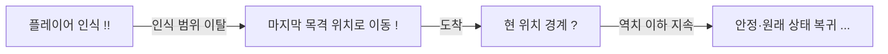

---
tags:
  - 소리도둑
  - 기획
정리일: 2026-10-27
---

# 사물과 경비원

## 소리 전달과 선택

소리 크기는 이산 등급이며 거리·환경을 반영해 전달한다. 벽 너머로도 들리고 울린다. 주입 소리는 출력 중 감지하며 반복 자극이 누적되면 잠든 경비병이 깨어난다.

소리 원인을 확인하러 이동하는 중에는 **현재 반응 중인 소리보다 높은 등급의 소리**가 발생하면 그 위치로 목표를 바꾼다. 같거나 낮은 등급으로는 이 규칙에 따른 변경을 하지 않는다. 여러 후보의 세부 가중치·동률 선택은 추후 결정한다.

## 인식·행동 상태와 표시

| 표시 | 의미 | 이동 목표 갱신 |
| --- | --- | --- |
| `!!` | 플레이어를 발견해 플레이어 방향으로 이동 | 인식되는 플레이어 위치를 계속 갱신 |
| `!` | 알고 있는 특정 위치까지 이동 | 목표 위치를 계속 갱신하지 않음 |
| `?` | 현재 위치에서 경계 | 멈춰 주변을 확인 |
| `...` | 현상 유지 | 원래 상태·행동 유지 |

일반 상태에서 플레이어를 발견하면 소리보다 플레이어를 우선해 `!!`로 이동한다. 회복 후 패닉은 이 전환보다 우선하는 예외다. 인식 범위 밖으로 사라지면 `!`로 바뀌고 **마지막으로 보였던 위치**를 목표로 고정한다. 그 위치에 도착하면 `?`가 된다. 인식 밖 플레이어 위치를 계속 추적하지 않는다.

소리 확인 이동과 플레이어 마지막 위치 확인 이동은 종료 조건을 구분한다. **소리 확인 중 소리가 끝나면 현재 위치에서 멈춰 `?`**, 플레이어를 놓쳤다면 **마지막 목격 위치까지 간 뒤 `?`**가 된다. 역치 이하의 자극이 지속되면 안정으로 전환해 원래 위치·상태로 복귀한다.

## 기절과 회복

투척 방출은 착지 지점에서 폭발해 범위 내 AI를 기절시킨다. 기절 효과는 벽에 막힌다. 기절 중에는 움직임과 모든 상호작용을 막는다.

AI가 기절에서 회복하면 **n초 동안 패닉 상태인 강제 `?`**가 된다. 일반 경계 `?`와 표시가 같더라도 상태의 전환 규칙은 구별한다.

패닉 중에는 플레이어 시야 인식·더 큰 소리 등 **어떠한 자극에도 `?` 상태가 고정**된다. 기절 공격을 다시 받아도 기절하지 않고 `?`를 유지한다. **패닉이 해제되어야 기절 공격이 다시 적용**된다. 패닉 지속 시간은 추후 조정한다.

## 발견과 실패의 구분

플레이어 발견은 `!!` 이동을 시작하는 사건이며 곧바로 의뢰 실패로 처리하지 않는다. 기존 ‘발견 게이지가 가득 차면 즉시 재시작’ 규칙은 이 흐름으로 대체한다. **경비병과 플레이어가 닿는 즉시 의뢰 실패**다. 별도 붙잡기 행동을 기다리지 않으며 해당 의뢰 전체를 초기화한다.

들고 있는 소리의 시간 초과 폭발은 플레이어 위치의 소음·자기 기절이며 그 자체로 게임 오버가 아니다. 던진 소리의 제한 시간이 먼저 끝나면 투척물의 공중 현재 위치에서 폭발한다. 전방 시야와 벽·닫힌 문의 시야 차단은 유지하고 수면 중 시야 판정은 미정이다. 채집·UI·배경 음악은 경비를 자극하는 게임 소리와 구별한다.

관련: [[02 소리 능력과 조작]] · [[06 튜토리얼 스테이지]] · [[09 미결정 사항]]
